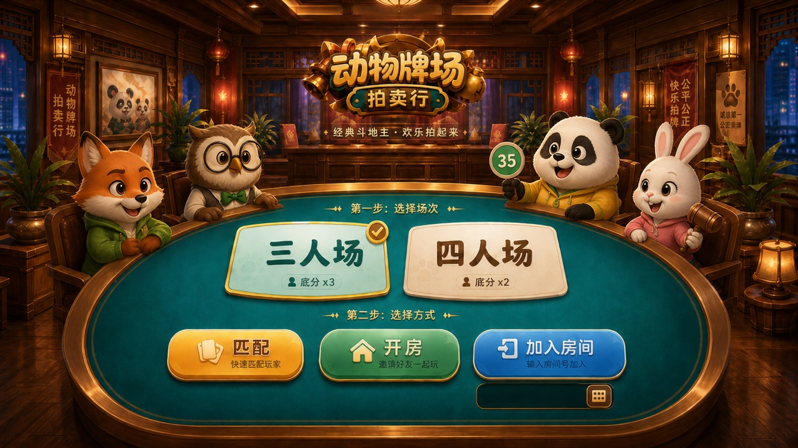

# 动物牌场拍卖行 / Animal Card Auction

面向 Steam Windows 的 3–4 人派对棋牌游戏原型。每局先拍卖道具，再进行带技能互动的斗地主，最后按名次结算积分。



## 特点

- 3 人 / 4 人分队列匹配，支持开房、房间码、满员开局与连续对局
- `Auction → Dealing → Playing → Finished` 服务端权威状态机
- 32 个主动/被动道具，支持同时触发、目标选择、猜拳、换牌等互动
- WebSocket 联机、断线重连、回合超时、自动托管与快捷语限频
- Cocos Creator 3.8.8 客户端与 Windows Native 构建链路
- 本地积分存档、每日负分恢复和 JSON `ScoreStore` 持久化

## 快速开始

环境要求：

- Node.js 20+
- npm

```bash
npm install
npm run dev
```

打开调试台：<http://127.0.0.1:8787>

```bash
npm test
npm run typecheck
```

## Cocos 客户端

1. 使用 Cocos Creator `3.8.8` 打开 `client/cocos`。
2. 先启动服务端 `npm run dev`。
3. 预览 `Main.scene`。

客户端默认连接 `ws://127.0.0.1:8787/ws`。可通过
`__PARTY_CARDS_SERVER_URL__` 注入其他服务器地址。

Windows 原生构建需要 Visual Studio 2022，并安装“使用 C++ 的桌面开发”工作负载。
辅助脚本位于 `client/cocos/scripts/`。

## 项目结构

```text
src/
  dou-dizhu/        牌型、牌堆、拍卖、对局与道具
  score/            积分、负分恢复与房间结算
  avatar/           动物形象与椅位角色
  server/           WebSocket 协议、GameHub 与调试服务
client/
  debug/            网页联机调试台
  cocos/            Cocos Creator 客户端
docs/
  游戏设计文档.md    完整玩法与产品规则
tests/              Vitest 测试
scripts/            构建、诊断与联调脚本
```

## 已知限制

- 当前是可运行原型，尚未在 Steam 上架
- 尚未接入 Steamworks 登录、排行榜与头像昵称
- 房间状态保存在内存，账号与积分使用本地 JSON 文件
- 美术与音频仍处于原型阶段

## License

源代码采用 [MIT License](LICENSE)。

第三方依赖遵循各自许可证。`docs/` 与 `client/cocos/assets/` 中的美术、音频素材仅用于本项目演示，
未单独授予商业再分发许可；二次开发或商业发布前请替换为自有素材。
